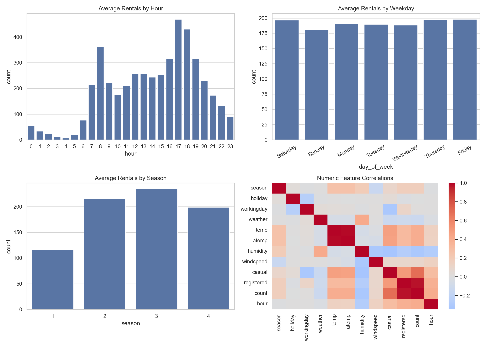
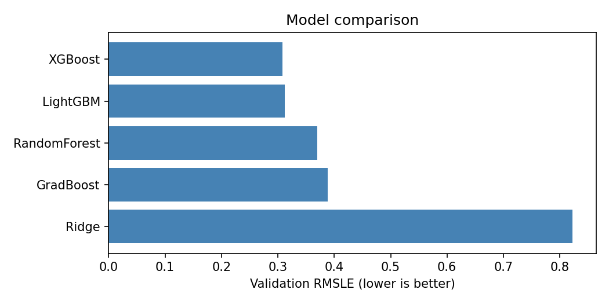
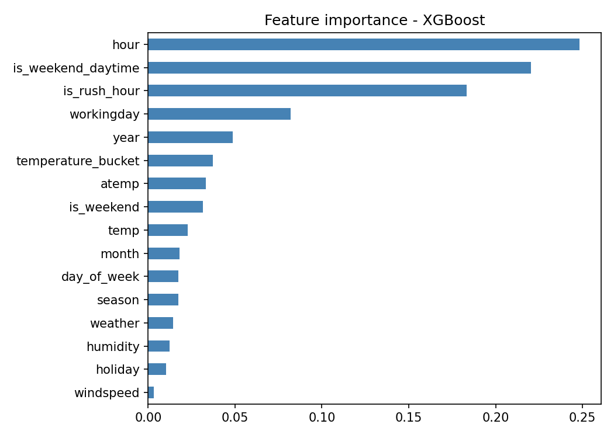
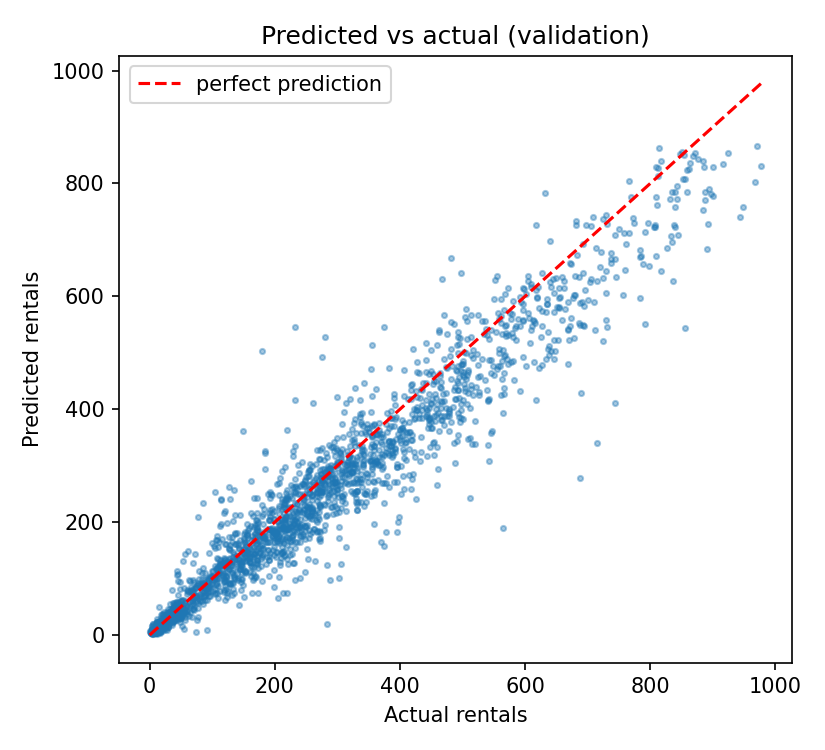
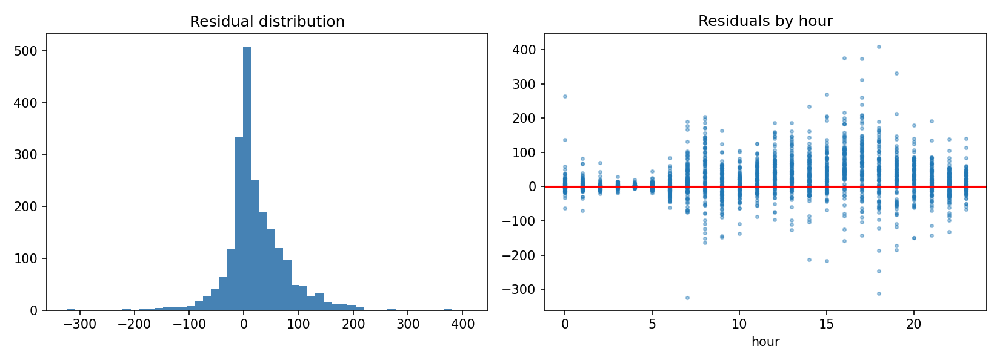

# ML-Bike-Rental-Demand-Forecasting
# Forecasting Bike Rental Demand

**UE24CS352A – Machine Learning | Mini-Project (Problem 87)**
PES University, Bangalore

Predicting the hourly number of bike rentals in Washington D.C. from calendar and weather information, using a trained XGBoost model and a Streamlit demo app.

| Team member | SRN |
|---|---|
| M B Divyadharshini | PES2UG24CS252 |
| Naija Arun Hodigere | PES2UG24CS296 |

## Contents
1. [Problem statement](#1-problem-statement)
2. [Dataset](#2-dataset)
3. [Approach](#3-approach)
4. [Results](#4-results)
5. [Repository structure](#6-repository-structure)
6. [Setup and how to run](#7-setup-and-how-to-run)
7. [Reproducibility](#8-reproducibility)
8. [Design decisions](#9-design-decisions)
9. [Limitations and future work](#10-limitations-and-future-work)
10. [Troubleshooting](#11-troubleshooting)
11. [Team contributions](#12-team-contributions)
12. [Deliverables](#12-deliverables)

---

## 1. Problem statement

Bike-sharing systems must decide how many bikes to stock and where to move them. Too few bikes lose customers, and too many raise storage and relocation costs, so a reliable forecast of hourly demand is valuable.

This is a **supervised regression** problem. Given the date, hour, calendar information and weather, we predict the total number of bikes rented in that hour (`count`) for the Capital Bikeshare system in Washington D.C. The problem is based on the Stanford CS229 (2014) report *Forecasting Bike Rental Demand* by Du, He and Zhechev.

## 2. Dataset

Kaggle **Bike Sharing Demand** competition data (Capital Bikeshare, Washington D.C.), stored in `data/raw/`.

| File | Rows | Notes |
|---|---|---|
| `train.csv` | 10,886 | 2011-01-01 to 2012-12-19; includes the target `count` |
| `test.csv` | 6,493 | No labels |

The training data covers days 1-19 of each month and the test data covers the remaining days.

**Inputs:** `datetime`, `season`, `holiday`, `workingday`, `weather`, `temp`, `atemp`, `humidity`, `windspeed`.
**Target:** `count` (mean 191.6, median 145, skewness 1.24). It is the sum of `casual` and `registered`, which are therefore excluded to prevent target leakage.

**Main findings from the exploratory analysis** (`outputs/eda/eda_report.md`):
- Demand peaks around 8 am and 5-6 pm (commuting) and is lowest overnight.
- Average demand is almost the same on every weekday, so the hour matters much more than the weekday alone.
- Season 3 has the highest demand and season 1 the lowest.
- Warmer weather raises rentals; humidity lowers them.



If `data/raw/` is empty, download `train.csv` and `test.csv` from the Kaggle competition *Bike Sharing Demand* and place them there.

## 3. Approach

```
raw CSV  ->  data_loader.py  ->  features.py  ->  17 features + log1p(count)
                                                          |
                                         chronological 80/20 split
                                                          |
                          Ridge | Random Forest | Gradient Boosting | XGBoost | LightGBM
                                                          |
                              tune best tree model  ->  keep the better on validation
                                                          |
                    refit on all labelled data  ->  models/best_model.joblib
                                                          |
                          modeling/predict.py  ->  Streamlit app (app/streamlit_app.py)
```

1. **Preprocessing** (`preprocessing/`): parse dates, drop invalid timestamps and duplicates, convert bad numeric values and fill them with the median.
2. **Feature engineering:** year, month, day, hour, day of week, weekend flag, weekday rush-hour flag (7-9 am and 5-7 pm), weekend daytime flag (10 am-6 pm) and a temperature bucket (17 features). `casual` and `registered` are blocked by a guard in the code.
3. **Target transform:** the target is skewed, so models are trained on `log1p(count)` and evaluated with **RMSLE** (also RMSE and R² on real counts). Predictions are converted back with `expm1` and clipped at 0.
4. **Validation:** a **chronological** split (first 80% of rows for training, 8,708; last 20% for validation, 2,178). A random split would overstate performance on time-dependent data.
5. **Models compared:** Ridge regression (linear baseline), Random Forest, Gradient Boosting, XGBoost and LightGBM.
6. **Tuning:** `RandomizedSearchCV` with `TimeSeriesSplit` (3 folds, 15 settings) on the best tree model.
7. **Final model:** the better of tuned and untuned (judged on validation) was the untuned XGBoost. It is refitted on all labelled data and saved with joblib.

## 4. Results

Scores on the chronological validation set (lower RMSLE and RMSE are better). Full table: `outputs/models/results.csv`.

| Model | RMSLE | RMSE | R² |
|---|---|---|---|
| **XGBoost (final)** | **0.3079** | **60.51** | **0.9227** |
| LightGBM | 0.3121 | 61.62 | 0.9198 |
| XGBoost (tuned) | 0.3276 | 71.29 | 0.8927 |
| Random Forest | 0.3701 | 80.46 | 0.8633 |
| Gradient Boosting | 0.3885 | 95.11 | 0.8090 |
| Ridge (baseline) | 0.8230 | 177.20 | 0.3369 |

The saved demo model is refitted on all labelled rows, so it cannot be scored fairly on the validation rows. The table reports the scores of the same configuration trained on the first 80% of the data only. The score can be reproduced with `python -m scripts.train_final_model`.



**Key observations**
- Tree-based models beat the linear baseline by a wide margin (RMSLE about 0.31-0.39 vs 0.82), because demand depends non-linearly on hour, temperature and calendar effects. This agrees with the reference paper.
- The engineered features pay off. The most important features are `hour`, `is_weekend_daytime` and `is_rush_hour`, followed by `workingday` and `year`.
- Tuning did not help: the tuned XGBoost scored worse on validation, so the untuned model was kept. The tuning folds sit earlier in time than the validation period.







The model tracks actual demand closely (R² = 0.92). It under-predicts at very high demand (above roughly 600 rentals) and errors are largest around the rush hours.


## 5. Repository structure

```
ML-Bike-Rental-Demand-Forecasting/
├── README.md
├── requirements.txt          # pinned library versions
├── app/
│   └── streamlit_app.py      # Streamlit demo
├── data/
│   ├── raw/                  # train.csv, test.csv
│   └── processed/            # train_features.csv, test_features.csv
├── preprocessing/
│   ├── data_loader.py        # load and validate the CSV files
│   └── features.py           # cleaning and feature engineering (shared by all code)
├── modeling/
│   ├── config.py             # paths, random seed, dropped features
│   ├── utils.py              # chronological split, metrics, model pipeline
│   └── predict.py            # predict_count / predict_one used by the app
├── notebooks/
│   └── 02_modeling.ipynb     # model comparison, tuning, plots, saves the model
├── scripts/
│   ├── prepare_data.py       # creates the processed CSV files
│   ├── run_eda.py            # creates the EDA figure and report
│   └── train_final_model.py  # quickly retrains the final XGBoost model
├── models/
│   └── best_model.joblib     # trained model used by the app
├── outputs/
│   ├── eda/                  # eda_overview.png, eda_report.md
│   ├── models/results.csv    # model comparison table
│   └── figures/              # result plots
├── docs/                     # app screenshot
└── report/                   # write-up PDF and presentation slides
```

## 6. Setup and how to run

**Requirements:** Python 3.10 or newer and Git. Run all commands from the project root.

### 6.1 Install

```bash
git clone https://github.com/winterwidow/ML-Bike-Rental-Demand-Forecasting.git
cd ML-Bike-Rental-Demand-Forecasting
python -m venv .venv
```

Activate the virtual environment:
- Windows PowerShell: `.\.venv\Scripts\Activate.ps1`
- Windows Git Bash: `source .venv/Scripts/activate`
- macOS/Linux: `source .venv/bin/activate`

```bash
pip install -r requirements.txt
```

### 6.2 Run the demo app

```bash
streamlit run app/streamlit_app.py
```

The app opens at `http://localhost:8501`. Choose a date, time and weather and press **Forecast rentals**. Sanity checks: a summer weekday at 8 am should predict several hundred rentals, and 3 am should predict very few.

### 6.3 Quick prediction from Python

```bash
python -m modeling.predict
```

or in code:

```python
from modeling.predict import predict_one
predict_one("2012-06-15 08:00", temp=24, humidity=55, windspeed=10, weather=1)
```

`weather`: 1 clear, 2 mist, 3 light rain/snow, 4 heavy rain/snow.

### 6.4 Recreate the processed data and EDA (optional)

```bash
python -m scripts.prepare_data --include-test   # writes data/processed/*.csv
python -m scripts.run_eda                       # writes outputs/eda/*
```

### 6.5 Retrain the model (optional)

**Quick option (about 1 minute, no Colab needed):**

```bash
python -m scripts.train_final_model
```

It trains the final XGBoost configuration, prints the chronological validation scores (RMSLE 0.3079, RMSE 60.51, R² 0.9227), refits on all labelled data and saves `models/best_model.joblib`. Use it if the saved model cannot be loaded on your machine.

**Full option (Colab):** `notebooks/02_modeling.ipynb` compares all five models, tunes the best one and creates `outputs/models/results.csv` and the figures. Steps:
1. Upload the whole project folder to Google Drive, e.g. `MyDrive/ml_mini_project/ML-Bike-Rental-Demand-Forecasting/`.
2. Open the notebook in Colab and set `ROOT` in the first cell to your Drive folder.
3. Run all cells (Runtime > Run all). It takes about 5-10 minutes and needs no GPU.

## 7. Reproducibility

- Random seed fixed at 42 (`modeling/config.py`).
- Library versions are pinned in `requirements.txt`. The saved model was trained with **scikit-learn 1.6.1** and **XGBoost 3.4.1** and should be loaded with the same versions. If you see a model-loading error, reinstall the pinned versions or run `python -m scripts.train_final_model`.
- The same preprocessing code (`preprocessing/features.py`) is used for training, evaluation and the app, so features cannot drift between them.

## 8. Design decisions

| Decision | Reason |
|---|---|
| Train on `log1p(count)`, score with RMSLE | The target is right-skewed; RMSLE matches the competition metric and treats errors proportionally |
| Chronological validation split | Demand is time-dependent; random splits leak future information |
| Exclude `casual` and `registered` | They sum to `count`, so using them is target leakage |
| Drop `day` inside the model pipeline | `day` is 1-19 in training and 20-31 in testing, so it cannot generalise. The pipeline still accepts all 17 features |
| Compute `year` relative to 2011 in `predict.py` | The shared feature code measures `year` from the smallest year in its input, which would be wrong for a single row |
| Keep the untuned XGBoost | The tuned model scored worse on validation |
| Refit the final model on all labelled data | More recent data helps predict the future; scores come from the held-out validation run |

## 9. Limitations and future work

- Under-prediction at very high demand; largest errors at rush hours.
- Test labels are not public, so the chronological validation split is our final evaluation and cannot be compared directly with Kaggle leaderboard scores.
- The model only saw 2011-2012. For later dates it treats `year` like the most recent training year, so it cannot capture long-term growth.
- Future work: lag and rolling-demand features, weather interaction features, and an ensemble of XGBoost and LightGBM.

## 10. Troubleshooting

| Problem | Fix |
|---|---|
| `ModuleNotFoundError: preprocessing` or `modeling` | Run from the project root, and use `python -m ...` for the scripts |
| `streamlit: command not found` | Activate the virtual environment and run `pip install -r requirements.txt` |
| Model fails to load or shows an XGBoost/scikit-learn version error | Reinstall the pinned versions from `requirements.txt`, or run `python -m scripts.train_final_model` to rebuild the model |
| `FileNotFoundError ... train.csv` | Put `train.csv` and `test.csv` in `data/raw/` |
| Port 8501 already in use | `streamlit run app/streamlit_app.py --server.port 8502` |

## 11. Team contributions

| Area | Divyadharshini | Naija |
|---|---|---|
| Data loading, preprocessing, feature engineering | | ✔ |
| Exploratory data analysis and EDA report | | ✔ |
| Model comparison, tuning and evaluation | ✔ | |
| Training notebook, model saving, figures | ✔ | |
| Prediction module (`modeling/`) | ✔ | |
| Final model training script and model compatibility fix | | ✔ |
| Streamlit app | | ✔ |
| README, write-up and slides | shared | shared |

## 12. Deliverables and references

- **Write-up (PDF):** `report/writeup.pdf`
- **Presentation slides:** `report/slides.pptx`
- **Repository access:** shared with the course faculty and teaching assistants.

